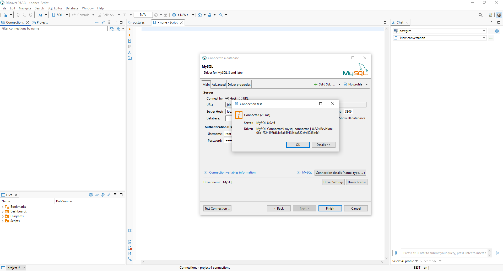
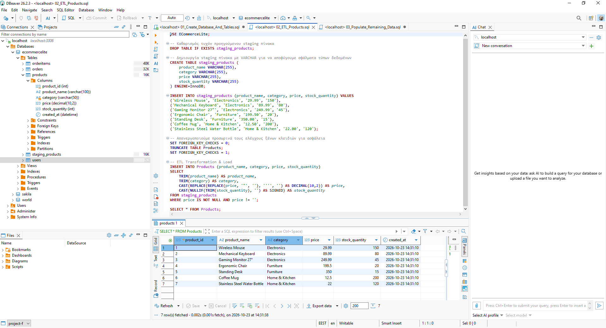
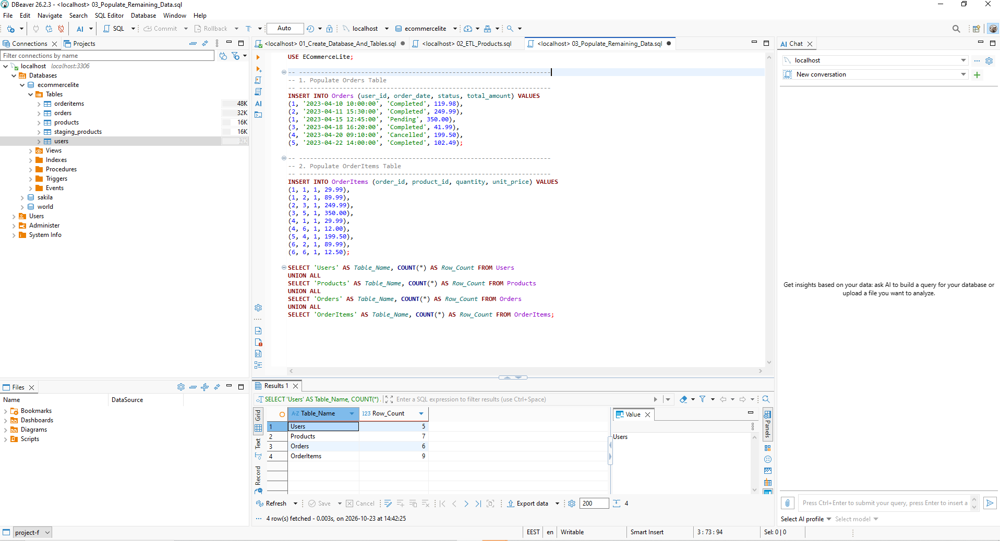
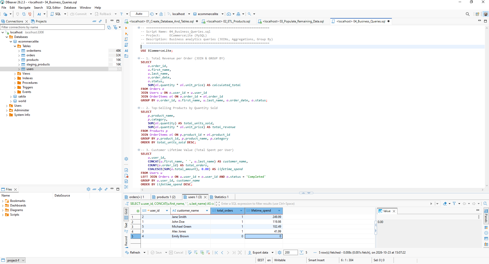
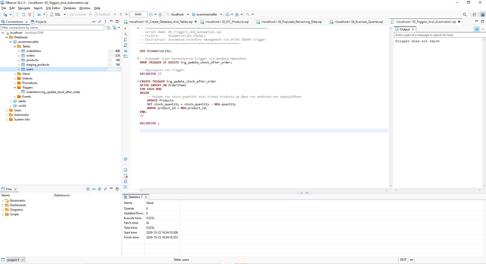

# 🛒 ECommerceLite - End-to-End SQL & ETL Pipeline

An enterprise-ready, lightweight MySQL database project simulating an e-commerce backend. It demonstrates clean data engineering workflows including **ETL data ingestion & cleansing**, **relational schema design**, **automated triggers**, and **business intelligence analytics**.

---

## 🛠️ Project Structure & Architecture

The project consists of modular SQL scripts and execution screenshots mapping each step of the pipeline:

1. **`00_Connection`**: Database connection setup.
2. **`01_Create_Database_And_Tables.sql`**: Schema definition (DDL) and referential integrity rules.
3. **`02_ETL_Products.sql`**: Staging table pattern and ETL data transformation pipeline (`TRIM`, `CAST`, `NULLIF`).
4. **`03_Populate_Remaining_Data.sql`**: Seed data population for Users, Orders, and OrderItems.
5. **`04_Business_Queries.sql`**: Business intelligence queries and data analytics.
6. **`05_Triggers_And_Automation.sql`**: Automated real-time inventory management using an `AFTER INSERT` trigger.

---

## 📸 Step-by-Step Implementation & Verification

### 0. Database Connection
* Initial connection and setup in the DBMS environment.

---

### 1. Database & Table Creation (`01_Create_Database_And_Tables.sql`)
* Created normalized relational tables (`Users`, `Products`, `Orders`, `OrderItems`) enforcing `PRIMARY KEY` and `FOREIGN KEY` constraints.

---

### 2. ETL Pipeline & Data Cleaning (`02_ETL_Products.sql`)
* Ingested raw product data into a staging table (`staging_products`) and transformed it using `TRIM()`, `REPLACE()`, `CAST()`, and `NULLIF()`.

---

### 3. Seed Data & Database Population (`03_Populate_Remaining_Data.sql`)
* Populated foundational transactional tables and cross-checked record counts.

---

### 4. Business Intelligence & Analytics (`04_Business_Queries.sql`)
* Executed key operational analytics including revenue calculations, top-selling products, and Customer Lifetime Value (CLV).

---

### 5. Automated Inventory Trigger (`05_Triggers_And_Automation.sql`)
* Developed an `AFTER INSERT` trigger (`trg_update_stock_after_order`) to automatically adjust product inventory upon new order placement.

---

## 🚀 Technologies Used
- **DBMS:** MySQL Server 8.0
- **Tool:** DBeaver Community
- **Version Control:** Git & GitHub

---

## 💡 Key SQL & Engineering Techniques Demonstrated
* **Data Cleaning & Casting:** `TRIM()`, `REPLACE()`, `CAST()`, `NULLIF()`
* **Defensive Programming:** `IFNULL(CONCAT(...))` for safe string concatenation and edge-case handling.
* **Database Automation:** Row-level triggers for implicit inventory synchronization.
* **Set-Based Operations:** Efficient table joins and aggregations instead of procedural loops.